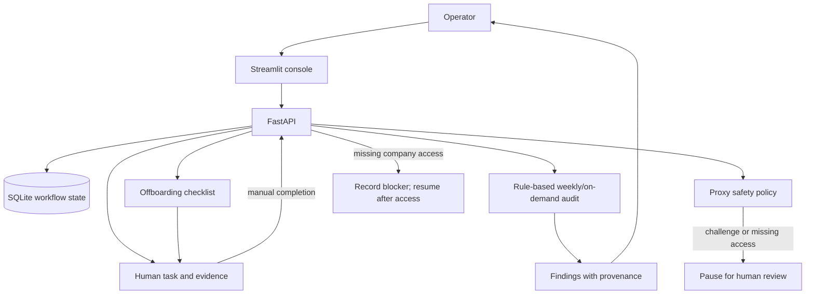

# Brand Operations Prototype

A local, human-gated coordination prototype for the GAJAN Group Holdings practical task. It does not automate Instagram signup, verification, profile changes, or access management. The supplied company test environment, vault, Meta business, and approved proxies were not available in this workspace, so the application uses synthetic demo data only.

## Status

- Implemented: FastAPI API, Streamlit operator UI, SQLite persistence, idempotent human-task creation, a nine-step human-only provisioning workflow, blocked/unverified register placeholders, masked register fields, rule-based audit, human offboarding tasks, a deterministic credential-free proxy failover simulation, synthetic records, Docker setup, evaluation fixtures, and documentation artifacts.
- Live or company integration evidence: none. No live account actions were performed.
- Blocked: company test access, approved vault integration, Meta authorization/interfaces, approved proxy reference and neutral endpoint, and live walkthrough recording.
- Weekly schedule, reminders, and overdue escalation are not configured. Task deadlines are stored, but notification requires an approved scheduler/channel.
- Optional Android sample-app fleet is omitted: no devices or neutral sample app were supplied. No social-app automation is included.

## Architecture



## Run locally

Requires Python 3.10+ (Pydantic v2). The system `python3` is 3.9.6; the app was installed and run successfully in `.venv` using the bundled Python 3.12 runtime.

```bash
python3.12 -m venv .venv
source .venv/bin/activate
pip install -r requirements.txt
export DATABASE_PATH=./data/prototype.db
uvicorn app.api:app --reload --port 8000
```

In a second terminal:

```bash
source .venv/bin/activate
export API_BASE_URL=http://localhost:8000
streamlit run app/ui.py --server.port 8501
```

Open `http://localhost:8501`; API docs are at `http://localhost:8000/docs`. If those ports are occupied, choose two free ports and set `API_BASE_URL` to the API port before starting Streamlit. Synthetic records are seeded at first startup. Delete the local database to reset demo state. Do not store real secrets in the sample database.

## Docker

```bash
docker compose up --build
```

Open Streamlit at `http://localhost:8501` and API docs at `http://localhost:8000/docs`. SQLite persists in the `prototype-data` volume. A real deployment needs a managed datastore, authentication/authorization, TLS, backups, migrations, monitoring, and company-approved secret-manager access.
If the default host ports are already in use, set `API_PORT` and `UI_PORT` for the compose command, for example `API_PORT=28173 UI_PORT=28174 docker compose up --build`. Port bindings are restricted to loopback for this local demo.

To use alternate local ports, run `API_PORT=28173 UI_PORT=28174 docker compose up --build -d` and stop with `API_PORT=28173 UI_PORT=28174 docker compose down`.

## API and error handling

Routes include `GET /health`, `GET|POST /api/accounts` (POST creates a blocked/unverified local register record only), `PATCH /api/accounts/{id}/profile` (records supplied values as unverified; does not change Instagram), `GET /api/handle-suggestions` (suggestions only), `GET /api/provisioning/steps`, `POST /api/accounts/{id}/provisioning-workflow` (creates nine ordered, idempotent human tasks), `GET|POST /api/tasks`, `PATCH /api/tasks/{id}`, `POST /api/audits/run`, `GET /api/findings`, `GET /api/offboarding/{account_id}/{person}`, `POST /api/offboarding/{account_id}/tasks` (creates four human tasks; performs no role or credential changes), `GET /api/proxy/policy`, `POST /api/proxy/simulate-failover` (synthetic control-flow only; makes no network connection), and `GET /api/events`.

Task creation requires a unique idempotency key. Repeating a key returns the existing task instead of duplicating it. Validation errors use FastAPI's 422 response; missing records use 404 with stable error codes; unexpected exceptions return a safe 500 response with correlation ID. This prototype has no authentication, authorization, rate limiting, CSRF protection for browser mutations, database migrations, or tamper-resistant audit storage.

The register and task endpoints do not create or mutate Instagram. Signup, verification, 2FA, profile setup, Meta linking, role changes, and vault operations remain human-gated. The nine tasks are ordered and instruct the operator to block later steps until authorization and prerequisites are cleared. A security challenge is a stop condition. The UI includes a guided checklist and register placeholder creation for an explicitly authorized test brand; it does not authorize a brand or account by itself.

## Security and tool choices

- FastAPI provides typed input validation and OpenAPI documentation. Streamlit provides a small operator UI.
- SQLite keeps the demo runnable without external services; it is not a production multi-user datastore.
- Only vault references are represented. Demo contacts use reserved `example.invalid` domains and placeholder phone digits; the API masks recovery fields.
- The proxy policy reports missing real configuration; the simulation shows bounded retry, failover, and challenge-pause logic using fixed synthetic outcomes. It makes no network connection, accepts no credentials, and is not evidence of a real proxy check. An approved vault reference and neutral test endpoint were not supplied.
- No external network integration currently runs, so retry/backoff is intentionally not applied to human tasks. Future supported transient calls need explicit timeouts and bounded retries.

## Evaluation

Run:

```bash
.venv/bin/python scripts/evaluate.py
```

The small golden set contains three synthetic audit cases and four expected findings. `scripts/evaluate.py` runs the same pure classification rules used by the API against those fixtures and reports TP=4, FP=0, FN=0, precision=1.000, recall=1.000, and F1=1.000 (4 labelled findings across 3 cases). This tiny in-sample fixture score is not live-account accuracy or independent integration validation. No statistical model is used, so model accuracy is not applicable. A previously performed local runtime check confirmed that posting the same task idempotency key twice returns the same task ID and marks the second response deduplicated; this was a single-path check, not load/failure testing. See `evaluation/` and `evidence/` for the data and sample reports.

## Human workflow

1. An authorized operator provisions the test email/phone and performs Instagram signup and verification manually.
2. The operator enables 2FA and stores passwords and backup codes in the approved vault; this app stores references only.
3. The operator completes profile/business setup and records provenance and verification date.
4. Create owner/deadline tasks for incomplete steps and record redacted evidence.
5. Run the audit, review findings, and create remediation tasks.
6. For offboarding, use the checklist to remove roles and rotate secrets through approved processes, then update the register after confirmation.
7. If a security challenge or platform restriction appears, pause, record the blocker, and resume only after an authorized human clears it.

## Evidence and submission status

- `evidence/account_register.json`: synthetic register snapshot.
- `evidence/weekly_audit_report.json`: synthetic/unverified audit example.
- `evidence/offboarding_report.json`: pending and blocked actions; no live changes.
- `evidence/sample_run.log`: redacted illustrative log.
- `DECISION_LOG.md`, `TRACEABILITY.md`, and `SUBMISSION_CHECKLIST.md`: decisions, coverage map, and remaining submission items.
- `ACCESS_REQUEST_DRAFT.md`: unsent request for the promised test resources or explicit alternative authorization.
- `LIVE_REQUIREMENTS_AND_SAFE_ALTERNATIVES.md`: what cannot be demonstrated without company access and the honest substitute for each item.
- `DEMO_WALKTHROUGH.md`: timed local synthetic demo script; it explicitly does not replace the required live recording.

No 2–3 minute live walkthrough recording was produced because no live test account/environment was supplied. This remains a required assignment deliverable; do not describe a synthetic walkthrough as a live one.
